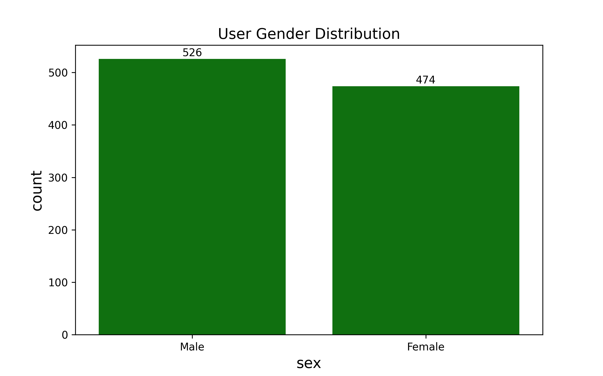
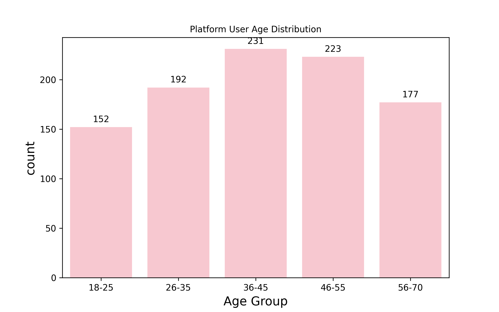
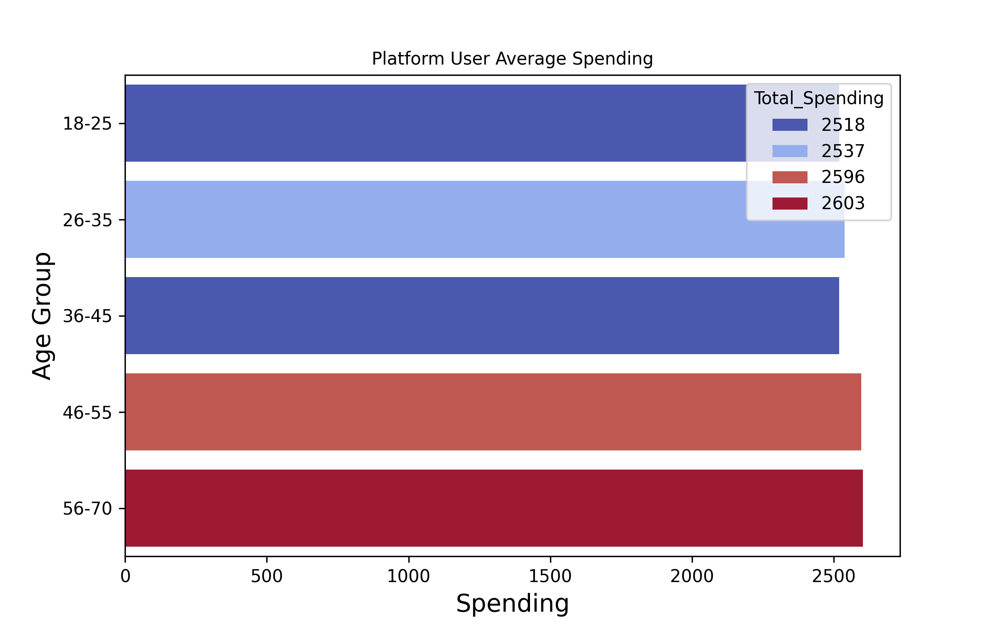
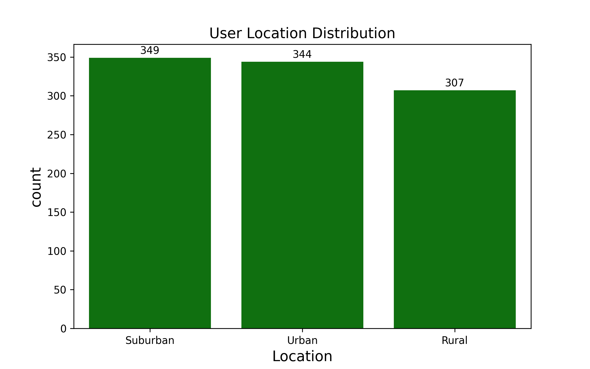
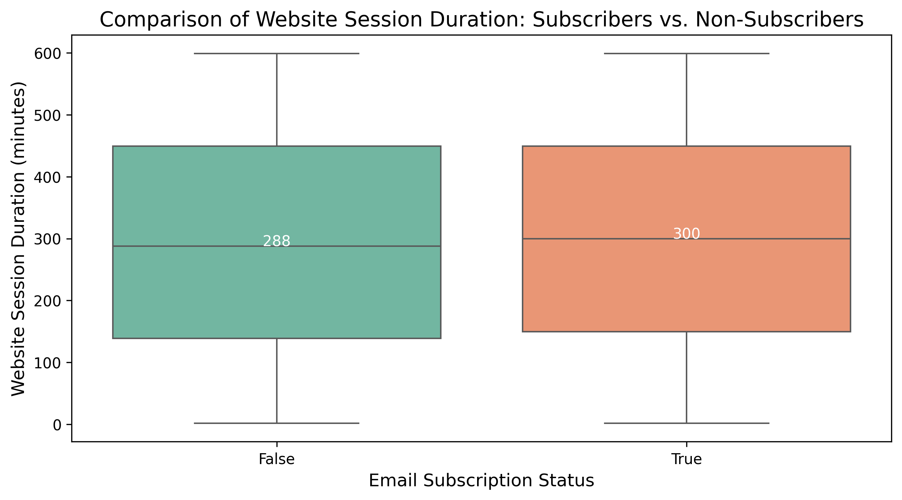
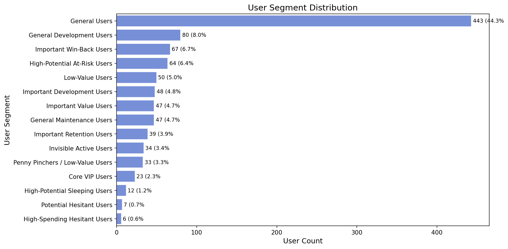
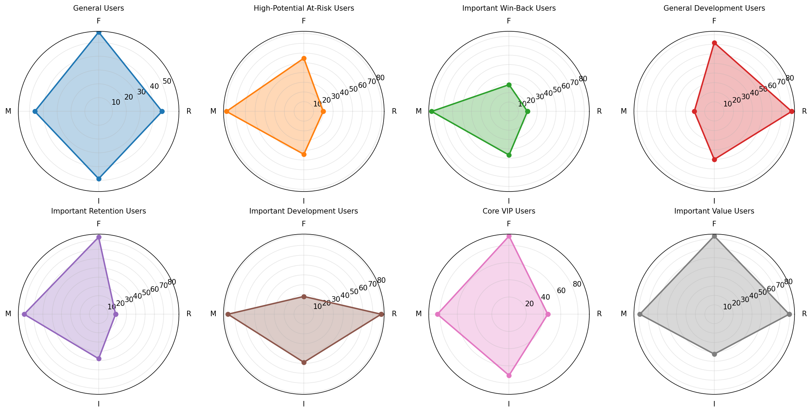
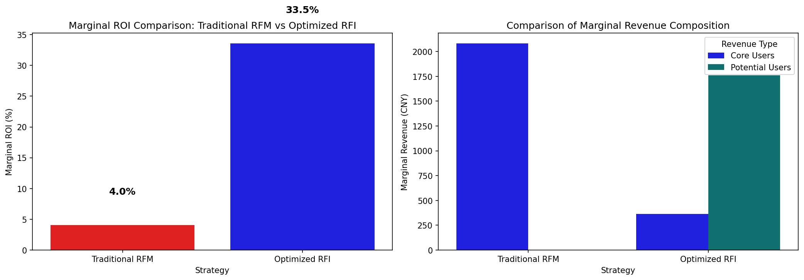

# RFM-RFI 用户价值分层与 ROI 优化

> 从传统 RFM 到多维 RFI 的升级：不只关注用户"花了多少"，更要看清用户"想不想买、为什么没买"。

---

## 📋 项目概述

本项目基于 **1000 名用户** 的电商行为数据，构建了一套改良版的 **RFM-RFI 用户价值分层模型**。在传统 RFM（Recency / Frequency / Monetary）模型基础上，创新性地引入 **意向度（Satisfaction）、转化摩擦系数（Friction）、活跃忠诚度（Loyalty）、购买力背景（Income Level）** 等多维指标，将用户细分为 **15 类精细化画像**，并通过对传统 RFM 策略与优化 RFI 策略的 **ROI 边际测算**，验证了改良模型在预算效率和投入产出比上的显著优势。

---

## 🎯 核心结论（TL;DR）

| 对比维度 | 传统 RFM 策略 | 优化 RFI 策略 |
|---------|:-----------:|:-----------:|
| 目标用户数 | 1000 人 | 159 人 |
| 预算使用率 | 100% | **15.9%** |
| 边际 ROI | 4.0% | **33.5%** |

> ✅ 优化 RFI 策略仅用 **15.9% 的预算** 实现了 **33.5% 的边际 ROI**，预算效率是传统 RFM 的 **8 倍以上**。

---

## 📊 数据概览

| 字段分类 | 字段名称 | 说明 |
|---------|---------|------|
| **基本信息** | User_ID, Age, Gender, Location, Income, Interests | 用户画像基础属性 |
| **行为特征** | Last_Login_Days_Ago, Time_Spent_on_Site_Minutes, Pages_Viewed, Newsletter_Subscription | 用户活跃度与粘性 |
| **消费特征** | Purchase_Frequency, Average_Order_Value, Total_Spending, Product_Category_Preference | 用户消费能力与偏好 |

- 数据规模：**1000 条 × 15 列**，无缺失值
- 男性 526 人（52.6%），女性 474 人（47.4%），性别分布均衡
- 郊区（349）+ 农村（307）用户合计占比 **65.6%**，是平台基本盘

---

## 🔄 分析流程

```
数据加载 → 用户属性分析 → 用户活跃度分析 → 改良RFM模型构建 → 用户分层画像 → ROI测算 → 业务结论
```

---

## 第一阶段：数据加载与预处理

- 检查数据质量（无重复值、无缺失值）
- 分类特征分布检验（性别、地域、兴趣、产品偏好均分布合理）
- 数值特征统计描述，确认无异常值

---

## 第二阶段：用户属性分析

### ① 性别分布

男女比例接近 1:1，用户群体性别均衡。



### ② 年龄分层

- **36-55 岁用户最多（434人，占 43.4%）**，是营收主力群体
- **18-25 岁年轻用户仅 152 人（15.2%）**，是用户增长的核心潜力缺口



### ③ 年龄 × 消费交叉分析

各年龄段消费水平接近（约 2500-2600 元），其中 **55 岁以上用户平均消费最高（2603 元）**，中老年群体消费能力不容忽视。



### ④ 地域分布

**郊区+农村用户合计占比 65.6%**，是平台基本盘。城市用户面临更多竞争，而郊区和农村用户更看重价格、依赖线上渠道，适合通过低价爆款和包邮策略刺激消费。



---

## 第三阶段：用户活跃度分析

### ① 用户活跃度分布（距上次登录天数）

- **核心用户**：上次登录约两周左右，既不是高频日活，也不是长期流失
- **流失风险**：25 天以上未登录用户仍较多，需关注

> 💡 **运营策略**：0-10 天用户做新手引导/专属福利；15-22 天用户推送召回；25 天以上用户做流失召回（优惠券+个性化推荐）

### ② 订阅 vs 非订阅用户停留时长对比

邮件订阅用户的网站停留时长**无显著优势**。两组均存在大量极短停留（0分钟，可能为误访问或流失用户）和极长停留（高价值深度浏览用户）。



### ③ 浏览行为与购买频次相关性

| 指标对 | 相关系数 |
|--------|:------:|
| 浏览时长 vs 购买频次 | ~0 |
| 浏览页数 vs 购买频次 | ~0 |

> 🔍 **关键发现**：存在大量 **"观光用户"**——贡献了流量和活跃度但未贡献 GMV。他们浏览意愿强但转化未触发，是等待转化的核心潜力池。

---

## 第四阶段：改良 RFM 模型 → RFI

### 传统 RFM 的局限性

传统 RFM 只看 **花钱**（R=最近购买、F=购买频率、M=消费金额），忽略了 **"逛"和"互动"** 的行为信号。

### 新增的五个维度

| 新增指标 | 公式/逻辑 | 业务含义 |
|---------|----------|---------|
| **意向度 (Satisfaction)** | 停留时长得分 × 0.5 + 浏览页数得分 × 0.5 | 用户是否有购买意愿 |
| **转化摩擦系数 (Friction)** | 浏览页数 / (购买次数 + 1) | 用户是否"看了很多但买得很少" |
| **活跃忠诚度 (Loyalty)** | 订阅状态 × 最近登录天数 → 1/2/3 分 | 真忠诚 vs 假忠诚 |
| **购买力层级 (Income Level)** | 收入 33%/66% 分位数 → Low/Medium/High | 有钱不花（高潜）vs 没钱不花（正常） |
| **兴趣匹配度 (Interest Match)** | 兴趣标签 == 购买品类偏好 | 推荐是否精准 |

### 综合评分公式

```
R_Score = Min-Max归一化(最近登录天数, 反向)
F_Score = Min-Max归一化(购买频率)
M_Score = Min-Max归一化(总消费金额)
RFM_Score = 0.2×R + 0.3×F + 0.5×M

Final_Score = RFM_Score × (1 + I_Weight)    # I_Weight = Satisfaction / 500
```

---

## 第五阶段：用户分层画像

基于改良模型将用户分为 **15 个精细化层级**：

### 分层逻辑拓扑

```
                 ┌─────────────────────────────────────────────┐
                 │          传统RFM三指标(R/F/M)初分类           │
                 │  重要价值 / 重要发展 / 重要保持 / 重要挽留     │
                 │       一般发展 / 一般维持 / 一般 / 低值       │
                 └─────────────────┬───────────────────────────┘
                                   │
                    ┌──────────────┼──────────────┐
                    ▼              ▼              ▼
              ┌──────────┐  ┌──────────┐  ┌──────────┐
              │ 意向度S  │  │ 收入层级  │  │ 摩擦系数  │
              └────┬─────┘  └────┬─────┘  └────┬─────┘
                   │              │              │
                   └──────────────┼──────────────┘
                                  ▼
                    ┌─────────────────────────┐
                    │    修正为15类精细标签     │
                    │ 核心VIP/纠结土豪/高潜沉睡 │
                    │  隐形活跃/犹豫潜力/...   │
                    └─────────────────────────┘
```

### 用户分布统计

| 用户分层 | 用户数 | 占比 | 平均消费 | 平均综合分 |
|---------|:----:|:----:|:------:|:--------:|
| General Users | 443 | 44.3% | 2368 | 54.3 |
| General Development Users | 80 | 8.0% | 1126 | 52.9 |
| Important Win-Back Users | 67 | 6.7% | 4134 | 58.6 |
| High-Potential At-Risk Users | 64 | 6.4% | 3991 | 65.4 |
| Low-Value Users | 50 | 5.0% | 1037 | 20.9 |
| Important Development Users | 48 | 4.8% | 3874 | 65.4 |
| General Maintenance Users | 47 | 4.7% | 1055 | 33.6 |
| **Important Value Users** | 47 | 4.7% | 3960 | **86.8** |
| Important Retention Users | 39 | 3.9% | 4030 | 75.3 |
| Invisible Active Users | 34 | 3.4% | 2757 | 47.3 |
| Penny Pinchers | 33 | 3.3% | 1003 | 37.0 |
| **Core VIP Users** | 23 | 2.3% | 4171 | **88.9** |
| High-Potential Sleeping Users | 12 | 1.2% | 1318 | 35.2 |
| Potential Hesitant Users | 7 | 0.7% | 739 | 34.7 |
| High-Spending Hesitant Users | 6 | 0.6% | 1157 | 30.2 |



### 典型用户群雷达图



**关键发现**：
- **核心 VIP** 和 **重要价值用户** 在 R/F/M/I 四个维度均表现突出（仅占 7%）
- **纠结土豪**（高收入、高意向、低消费）和 **高潜沉睡用户**（高收入、高意向、RFM低）是传统 RFM **无法识别**的高价值增量人群
- **隐形活跃者**（低收入、高意向、低购买）是有流量价值的潜力用户

---

## 第六阶段：ROI 测算对比

### 测算逻辑（边际增量法）

```
边际增量收益 = 目标用户数 × 边际转化提升 × 平均客单价
边际 ROI = (增量收益 - 优惠券成本) / 优惠券成本 × 100%
```

### 关键假设

| 假设项 | 传统 RFM 策略 | 优化 RFI 策略 |
|--------|:----------:|:----------:|
| 目标用户 | RFM 前 20% | 核心 VIP + 潜力用户 |
| 自然转化率 | 20% | 核心 25% / 潜力 1% |
| 发券后转化率 | 30% | 核心 30% / 潜力 20% |
| 边际提升 | 10% | 核心 5% / 潜力 **19%** |
| 总预算 | 10,000 元 | 10,000 元 |
| 优惠券成本 | 10 元/人 | 10 元/人 |

### 对比结果



| 指标 | 传统 RFM (方案A) | 优化 RFI (方案B) |
|------|:-----------:|:-----------:|
| **目标用户数** | 1000 人 | 159 人 |
| **实际成本** | 10,000 元 | 1,590 元 |
| **预算使用率** | 100% | 15.9% |
| **增量收益** | 10,400 元 | 2,122 元 |
| **边际 ROI** | 4.0% | **33.5%** |

> 🎯 优化 RFI 策略虽然增量收益绝对值略低于传统方案，但 **每元预算的投入产出效率提升了 8 倍以上**。在预算有限场景下，这一策略更具实操价值。

---

## 💼 业务建议

1. **精准投放，优先触达高潜人群**：将有限预算优先分配给核心 VIP（23人）和高潜沉睡/纠结土豪用户（25人），ROI 最大化
2. **观光用户转化专项**：针对浏览多但买得少的用户，设计"首单立减""限时折扣"等转化钩子
3. **郊区/农村用户差异化运营**：以低价爆款、包邮策略为核心，区别于城市用户的品质种草路线
4. **流失预警机制**：对"上次登录 > 25 天 + 高消费"的高潜流失客，提前触发优惠券召回
5. **邮件订阅价值重估**：当前订阅用户与未订阅用户的活跃度无显著差异，需优化邮件内容策略或重新评估渠道价值

---

## 🛠 技术栈

- **Python 3.x**
- **Pandas** — 数据处理与特征工程
- **NumPy** — 数值计算
- **Matplotlib + Seaborn** — 数据可视化
- **Scikit-learn** — 相关性分析

---

## 📁 项目结构

```
RFM-RFI用户价值分层与ROI优化/
│
├── RFM-RFI_exercise.ipynb          # 完整分析主程序
├── user_personalized_features.csv  # 用户数据（1000条×15列）
├── README.md                       # 项目说明文档
│
├── 用户性别分布.png                 # 可视化输出
├── 用户年龄分布.png
├── 年龄层消费对比.png
├── 用户区域分布.png
├── 订阅用户活跃度对比.png
├── segment_distribution.png        # 用户分层分布图
├── segment_radar.png               # 用户分层雷达图
├── roi_comparison.png              # ROI对比图
└── segment_stats.csv               # 分层统计数据导出
```

---

## 🚀 快速复现

```bash
# 1. 安装依赖
pip install pandas numpy matplotlib seaborn

# 2. 启动 Jupyter
jupyter notebook

# 3. 打开 RFM-RFI_exercise.ipynb → Run All
```

---

## 📝 设计理念

> 本项目遵循 **"业务理解优先于特征堆砌"** 的建模原则：
> - 特征分类遵循业务逻辑（属性 → 行为 → 消费），而非盲目入模
> - 购买力（Income）等背景信息作为 **分层标签** 而非评分因子，保持评分体系的因果纯净性
> - ROI 测算采用 **边际增量法**，关注"发券带来的额外转化"，而非混淆自然转化
> - 模型的最终目标是 **可落地的运营策略**，而非仅追求数学精度

---

*Created by: Data Analysis Practice Project | 2026-07*
